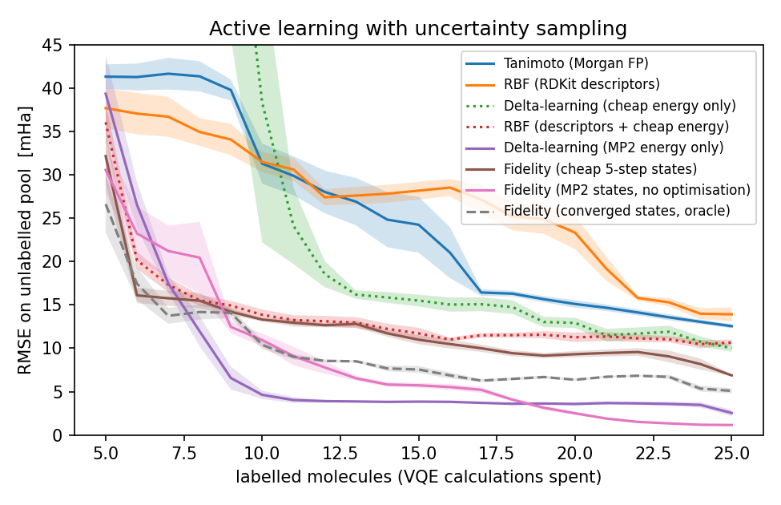

# Quantum kernels as surrogates in active learning on quantum-chemical labels

Prototype for a master project in Quantum Machine Learning (Ca' Foscari University, Venice).

> **Status (11 Nov 2026).** Pool A results were regenerated after cleaning a duplicated
> label cache (every molecule appeared twice, which let state kernels "see" the copy of
> an unlabelled molecule). The numbers below replace the earlier ones. Pool B results are
> unchanged and still preliminary: its labels show an active-space consistency problem
> described under *Caveats*.

## Question

When every training label costs an expensive quantum-chemical calculation, the
*surrogate model* that chooses which molecule to compute next decides how many
calculations are needed. Does a quantum similarity measure between molecular
states drive that choice better than a classical one — and better than the
cheap classical proxies chemistry already has?

## Protocol

- **Pool A** (`qkal/pool.py`): 38 small closed-shell organics (2–4 heavy atoms,
  C/N/O/F), geometries from RDKit (ETKDG + MMFF; not ab-initio equilibria).
- **Pool B** (`qkal/pool_strong.py`): 44 geometries along bond stretches
  (N₂, C₂H₂, H₂O, HCN, 0.9–2.3 × r_eq) and the ethylene torsion (0–90°),
  i.e. the regime where single-reference methods break down.
- **Active space**: 4 electrons in 4 orbitals, STO-3G → 8 qubits, built with PennyLane/PySCF.
  Every label passes three consistency checks (qubit HF = PySCF SCF, UCCSD(θ=0) = HF,
  VQE ≥ exact) before it is stored.
- **Label**: exact active-space correlation energy `E_exact − E_HF` (CASCI by diagonalisation).
  A UCCSD-VQE (Adam, lightning.qubit) produces the *states*; its gap to the exact energy is reported.
- **Surrogates**: a Gaussian process with one of the following Gram matrices. The rule of
  the protocol: the input must be available *before* the label is paid for. The only
  exception is the oracle, which is kept as an upper-bound reference, not as a usable surrogate.

  | Surrogate | Input | Cost of the input |
  |---|---|---|
  | Tanimoto / Morgan FP | SMILES | ~0 |
  | RBF / RDKit descriptors (pool A) or geometry features (pool B) | SMILES / geometry | ~0 |
  | Δ-learning on the MP2 energy | `E_MP2 − E_HF` (scalar) | one MP2 (ms) |
  | Fidelity between **MP2-initialised UCCSD states** | state vector | one MP2 + one circuit |
  | Fidelity between states after *k* VQE steps (k = 1, 2, 5, 10, 20) | state vector | k/≈85 of a label |
  | Fidelity between **converged VQE states** (*oracle*: uses the label itself) | state vector | the full label |

- **Loop**: 5 random labelled molecules → GP → acquire the most uncertain → repeat to 25;
  10 seeds; random acquisition as control.
- **Metric**: RMSE on the still-unlabelled pool after each acquisition (*labels-to-accuracy*),
  not final accuracy.
- **Diagnostics**: spread of off-diagonal kernel values and effective rank
  (first concentration check, after Thanasilp et al., Nat. Commun. 2024).

## Results on pool A (38 molecules, 25 labels, 10 seeds)

Target: mean −33 mHa, std 40 mHa. The VQE sits 0.15 mHa above the exact energy on
average (max 1.2 mHa).

| Surrogate | final RMSE [mHa] | AUC uncertainty | AUC random | off-diag mean ± std | eff. rank |
|---|---|---|---|---|---|
| Tanimoto (Morgan FP) | 12.6 | 523 | 744 | 0.05 ± 0.08 | 33.4 |
| RBF (RDKit descriptors) | 13.9 | 561 | 651 | 0.38 ± 0.22 | 8.9 |
| Δ-learning on the 5-step VQE energy (scalar) | 10.0 | 1274 | 3949 | 0.42 ± 0.37 | 3.9 |
| RBF (descriptors + 5-step energy) | 10.7 | 293 | 641 | 0.39 ± 0.23 | 8.4 |
| Fidelity, 5-step VQE states | 6.9 | 260 | 539 | 0.80 ± 0.12 | 2.6 |
| Fidelity, converged states (oracle) | 5.1 | 201 | 413 | 0.95 ± 0.05 | 1.3 |
| **Δ-learning on the MP2 energy (scalar)** | **2.5** | **161** | 2519 | 0.45 ± 0.39 | 3.8 |
| **Fidelity, MP2-initialised states** | **1.1** | 181 | 551 | 0.99 ± 0.01 | 1.1 |



Cost scan of the fidelity kernel (final RMSE, mHa · effective rank): 1 step 22.2 · 3.7 —
2 steps 11.8 · 1.9 — 5 steps 6.9 · 2.6 — 10 steps 10.7 · 1.7 — 20 steps 10.8 · 1.5 —
MP2 state 1.1 · 1.1 — converged 5.1 · 1.3.

### What this says

1. **MP2 information wins, in either form.** The two best surrogates are both derived
   from MP2: a GP on the single number `E_MP2 − E_HF` reaches 2.5 mHa with 25 labels,
   the fidelity kernel between MP2-initialised (unoptimised) states reaches 1.1 mHa. Both
   beat every other state kernel, including the oracle (5.1 mHa). On closed-shell
   molecules near equilibrium the ratio exact/MP2 is a fingerprint of the chemical class
   (≈0.58–0.65 for saturated molecules, 0.46–0.50 for C=C and C=O, 0.65–0.67 for triple
   bonds and nitriles), and the GP learns the rest.
2. **The state kernels are, in effect, one number.** Fidelity kernels between MP2 or
   converged states have effective rank 1.1–1.3; the MP2-state kernel has off-diagonal
   values 0.993 ± 0.010, i.e. it is almost constant. The overlap is dominated by how far
   each state sits from HF — the correlation energy itself. Such a concentrated kernel is
   numerically delicate and would become unusable at larger qubit counts.
3. **Cheminformatic descriptors are the wrong classical baseline for a quantum-chemical
   target.** Morgan fingerprints and RDKit descriptors do not encode what decides the
   label (multiple bonds, near-degeneracies); comparing a quantum kernel against them
   is how an apparent "quantum advantage" appears.
4. **States along the optimiser trajectory are not a cost knob.** Accuracy vs number of
   VQE steps is non-monotonic (5 steps beat 2, 10 and 20), and the effective rank
   decreases monotonically with optimisation (3.7 → 1.3): the structure of early states
   is optimiser noise, not chemistry. The MP2 state is the right deterministic cheap state.
   The scalar 5-step energy is the extreme case: its GP starts at ≈300 mHa with 5 labels.
5. **Uncertainty sampling matters most for the 1-D MP2 model** (AUC 161 vs 2519 random),
   which extrapolates badly until the extremes are labelled.

Concentration is not the bottleneck at 8 qubits and 38 molecules (the most
concentrated kernels perform best); it will be at larger sizes.

## Pool B: strong correlation (44 geometries, 25 labels, 10 seeds) — preliminary

MP2 is a near-perfect proxy exactly where nobody needs a quantum computer.
Pool B scans into strong correlation (stretched N₂, C₂H₂, H₂O, HCN; twisted
ethylene) to test whether the MP2 scalar still suffices, or whether a kernel on
the state carries information the scalar does not.

| Surrogate | final RMSE [mHa] | AUC uncertainty | AUC random | eff. rank |
|---|---|---|---|---|
| RBF (geometry features) | 43.2 | 1316 | 2664 | 6.2 |
| Δ-learning on the MP2 energy (scalar) | 39.0 | 7551 | 14587 | 3.5 |
| RBF (geometry + 5-step energy) | 29.8 | 900 | 1806 | 6.0 |
| Fidelity, MP2-initialised states | 29.6 | 1348 | 6617 | 1.4 |
| Fidelity, converged states (oracle) | 25.5 | 965 | 1602 | 4.7 |

Target spread is 140 mHa (vs 40 mHa in pool A); the VQE sits 2 mHa above the exact
energy on average (max 28 mHa at the most stretched geometries).

- **The MP2 scalar collapses** (worst AUC of all): single-reference proxies stop being
  informative in this regime, as expected.
- **Converged states regain structure**: the oracle's effective rank rises from 1.3 to 4.7
  and it is the best surrogate. The MP2 state does not inherit this (rank 1.4): a
  single-reference state cannot see multi-determinant structure.
- **Nothing is good yet** (best RMSE ≈ 18 % of the target spread), and part of the reason
  is in the labels, not in the surrogates: see the active-space caveat below. The geometry
  baseline is also weak (fixed RBF length scale, no per-family treatment), and 25 labels
  across five one-parameter curves are few.

## Open question

Near equilibrium the cheapest proxy suffices; in strong correlation the useful
information exists only in the converged state, which costs as much as the label.
*Which representation of the state, obtainable at low cost before labelling, keeps
enough multireference information to improve the active-learning choices?*

**Next steps, in order:**

1. **Consistent active space along each pool-B curve** (orbital tracking by overlap with
   the previous geometry, or natural orbitals from a cheap calculation), then relabel pool B.
2. **Resolve the MP2 anomalies** (see Caveats) and regenerate both pools.
3. **GP hyperparameters by marginal likelihood** for all kernels, so that the classical
   baseline of pool B is fair.
4. **Features from the 1-RDM** (natural occupation numbers, orbital entropies) instead
   of the full-state fidelity: invariant under orbital rotations, chemically interpretable,
   and estimable on hardware with polynomially many measurements (classical shadows,
   projected quantum kernels).
5. **A cost ladder on the same feature space**: MP2 density → low-bond-dimension DMRG →
   shallow circuit (MPS-initialised) → converged state. The quantum rung must beat the
   tensor-network rung at comparable cost.

## Run

```bash
pip install -r requirements.txt
python check_pool.py                 # HF/active-space sanity check, no VQE
python run_labels.py                 # pool A labels, ~40 s/molecule, cached incrementally in data/
python run_al.py                     # comparison → results/
python run_scan.py                   # cost scan → results/
python run_labels.py --strong        # pool B → data_strong/
python run_al.py --strong            # → results_strong/
python run_scan.py --strong
```

`run_labels.py` appends to an existing cache; if a cache is rebuilt from a different
version, check for duplicated names before running `run_al.py`
(`dedupe.py` keeps the last entry of each molecule and realigns `states.npz`).

## Caveats

- 8-qubit states are trivially simulable: the subject is the *protocol*, not advantage.
- **Active-space consistency (pool B).** The CAS(4,4) is selected by orbital energy. Along
  the stretches and the ethylene torsion, orbitals cross and the active space changes
  composition between neighbouring geometries; the active-space correlation energy then
  jumps non-physically (e.g. ethylene: −44, −7, −133, −11 mHa at 0°, 15°, 30°, 45°;
  C₂H₂: −280 mHa at 1.6 r_eq, −179 at 1.8). The largest VQE–exact gaps sit at the same
  geometries. Pool-B labels are therefore partly artefacts until the active space is
  tracked consistently along each curve.
- **MP2 anomalies.** For N₂ and CO₂ in pool A, and for contiguous blocks of pool-B
  geometries, `E_MP2 − E_HF` has the wrong sign (the ratio exact/MP2 is ≈ −0.13 in all
  of them). A standard RHF-MP2 correction cannot be positive; the reference used for
  `e_mp2` and `e_hf` is being checked. These points are suspect in both pools.
- Fidelities compare states in each molecule's own canonical-orbital basis; overlaps mix
  physics with basis conventions. Orbital localisation, a shared reference, or
  basis-invariant features (1-RDM eigenvalues) are the fixes.
- Pool A geometries come from a force field; N₂ in particular is far from its ab-initio
  bond length and dominates the target range (−211 mHa vs −1 to −60 for the rest).
  Pool B uses explicit internal coordinates.
- Small pools, one active-space size (CAS(4,4) is too small for the triple bond of N₂);
  conclusions about scaling need more.

## Planned extensions

Features from reduced density matrices (projected quantum kernels, classical shadows);
tensor-network states as the classical cheap-representation baseline and as warm start for
shallow circuits; measurement-budget-aware acquisition; larger active spaces; DFT labels on
QMugs as a classical control.
